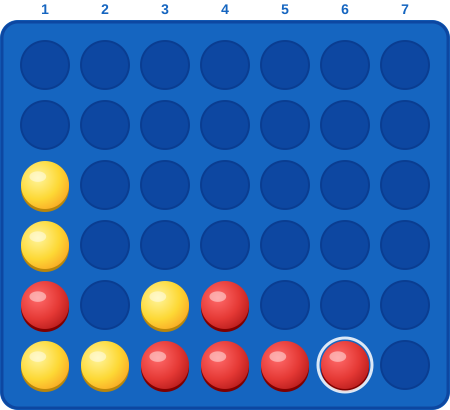

# 🔴🟡 Connect 4 — Jogo Comunitário

Bem-vindo ao **Connect 4 colaborativo**! Qualquer pessoa pode jogar — basta abrir uma *Issue*.

🎮 **É a vez do jogador:** 🟡 Amarelo

## 🎲 Tabuleiro

  

### 🎯 Escolha uma coluna

[▶ Jogar na coluna 1](https://github.com/CarlosNatyel/CarlosNatyel/issues/new?title=Move%3A%201&body=Jogada%3A%20coluna%201) &nbsp;&nbsp; [▶ Jogar na coluna 2](https://github.com/CarlosNatyel/CarlosNatyel/issues/new?title=Move%3A%202&body=Jogada%3A%20coluna%202) &nbsp;&nbsp; [▶ Jogar na coluna 3](https://github.com/CarlosNatyel/CarlosNatyel/issues/new?title=Move%3A%203&body=Jogada%3A%20coluna%203) &nbsp;&nbsp; [▶ Jogar na coluna 4](https://github.com/CarlosNatyel/CarlosNatyel/issues/new?title=Move%3A%204&body=Jogada%3A%20coluna%204) &nbsp;&nbsp; [▶ Jogar na coluna 5](https://github.com/CarlosNatyel/CarlosNatyel/issues/new?title=Move%3A%205&body=Jogada%3A%20coluna%205) &nbsp;&nbsp; [▶ Jogar na coluna 6](https://github.com/CarlosNatyel/CarlosNatyel/issues/new?title=Move%3A%206&body=Jogada%3A%20coluna%206) &nbsp;&nbsp; [▶ Jogar na coluna 7](https://github.com/CarlosNatyel/CarlosNatyel/issues/new?title=Move%3A%207&body=Jogada%3A%20coluna%207)

_Clique em um link, confirme a Issue e o tabuleiro será atualizado automaticamente._

### 📜 Últimos movimentos

- 🔴 coluna **1** (linha 5)
- 🟡 coluna **1** (linha 6)
- 🔴 coluna **4** (linha 6)

---

## 📖 Como jogar

1. Escolha uma coluna clicando em um dos links acima.
2. Uma **Issue** será aberta com o movimento pré-preenchido.
3. Clique em **Submit new issue**.
4. Um **GitHub Action** processa a jogada, atualiza o tabuleiro e fecha a Issue automaticamente. ✨

## 📏 Regras

- Tabuleiro de **6 linhas × 7 colunas**.
- Os jogadores alternam entre 🔴 e 🟡.
- Vence quem alinhar **4 peças consecutivas** na horizontal, vertical ou diagonal.
- Se o tabuleiro encher sem vencedor, é **empate**.

## ⚙️ Como funciona

Este jogo usa **GitHub Issues** como interface de entrada e **GitHub Actions** como motor. Cada Issue é interpretada por um workflow que valida a jogada, atualiza `game_state.json`, regenera o SVG do tabuleiro e o README.

Inspirado no [xadrez comunitário de Tim Burgan](https://github.com/timburgan/timburgan).
